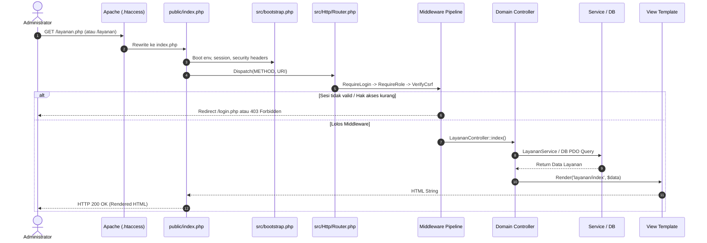
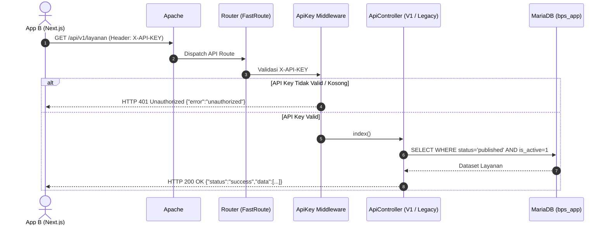
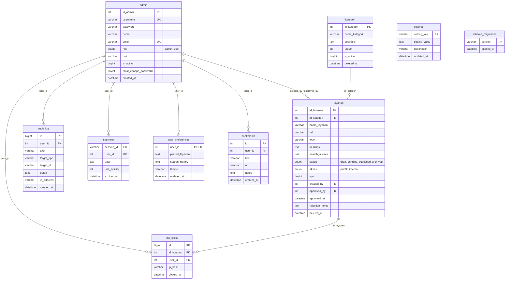

# Arsitektur Sistem — BPS Kabupaten Solok Selatan

Dokumen ini mendokumentasikan arsitektur teknis **App A** (`adminDashboard` / `administators.bps1310.cloud`), mencakup diagram alur request, struktur modul kode, matriks hak akses/role, dan desain skema database relasional (pemenuhan **Task 9.2** pada `todo.md`).

---

## 1. Prinsip & Pola Arsitektur

Arsitektur App A dirancang dengan pendekatan **modern native PHP** berbasis prinsip *Separation of Concerns* (SoC), *KISS (Keep It Simple, Stupid)*, dan *Ponytail Mindset* (tanpa abstraksi berlebih atau dependensi framework monolitik yang membengkak):

1. **Front Controller Pattern:** Seluruh request web dan panggilan API diarahkan secara sentral ke satu-satunya pintu masuk publik: [`public/index.php`](file:///c:/xampp/htdocs/adminDashboard/public/index.php).
2. **Layered Architecture:**
   - **HTTP Layer (`src/Http/`):** Router FastRoute, Middlewares pipeline, dan Controller per domain fungsional.
   - **Service Layer (`src/Services/`):** Logika bisnis murni (Approval layanan, Password hashing & lockout, Throttling, Mailer).
   - **Support / Infrastructure Layer (`src/Support/`):** Pembungkus basis data PDO, sesi terenkapsulasi, CSRF helper, validator, dan centralized logging.
   - **Presentation Layer (`src/views/`):** Template UI bersih, modular, dan terpisah dari logika manipulasi database.
3. **Database Privilege Separation:** Pemisahan akun database `bps_app` (CRUD terbatas) dan `bps_migrator` (DDL skema).

---

## 2. Diagram Alur Request (Request Lifecycle)

### 2.1 Alur Request Web Dashboard



### 2.2 Alur Request REST API (App B Portal)



---

## 3. Struktur Direktori & Pemetaan Namespace

Aplikasi menerapkan pemetaan otomatis **PSR-4 Autoloading** dengan root namespace `App\` mengarah ke folder `src/`:

```text
src/
├── Http/
│   ├── Controllers/
│   │   ├── Controller.php               # Base Controller (render, redirect, auth user)
│   │   ├── AdminController.php          # Manajemen akun admin & approval registrasi
│   │   ├── AuthController.php           # Autentikasi dashboard (login, logout)
│   │   ├── DashboardController.php      # Ringkasan statistik & aktivitas audit
│   │   ├── KategoriController.php       # CRUD kategori statistik & soft-delete
│   │   ├── LayananController.php        # CRUD layanan, upload logo, export/import CSV
│   │   ├── PengaturanController.php     # Pengaturan sistem & ubah password akun
│   │   └── Api/
│   │       ├── LegacyApiController.php  # Rute warisan App B (/api/layanan.php, dsb)
│   │       └── V1/ApiController.php     # REST API V1 (/api/v1/*)
│   ├── Middleware/
│   │   ├── MiddlewareInterface.php      # Kontrak middleware handler
│   │   ├── ApiKey.php                   # Verifikasi X-API-KEY App B
│   │   ├── RequireLogin.php             # Penjaga sesi dashboard admin
│   │   ├── RequireRole.php              # Pengecekan role RBAC (admin vs user)
│   │   └── VerifyCsrf.php               # Validasi token CSRF pada POST/PUT/DELETE
│   └── Router.php                       # Mesin FastRoute & middleware pipeline
├── Services/
│   ├── LayananService.php               # Validasi & status workflow layanan
│   ├── LoginThrottleService.php         # Pembatasan laju & lockout brute-force
│   ├── Mailer.php                       # Wrapper pengiriman email notifikasi
│   └── PasswordService.php              # Hashing Bcrypt, validasi kebijakan, & upgrade hash
└── Support/
    ├── AuditLogger.php                  # Pencatatan aktivitas ke tabel audit_log
    ├── Csrf.php                         # Generator & verifikator token CSRF
    ├── Database.php                     # Koneksi lazy PDO singleton
    ├── Json.php                         # Standarisasi respon JSON envelope
    ├── Logger.php                       # Centralized logger dengan sanitasi rahasia
    ├── SecurityHeaders.php              # CSP, HSTS, X-Content-Type-Options
    ├── Session.php                      # Manajemen siklus hidup sesi aman
    ├── Validator.php                    # Sanitasi & validasi input kuat
    ├── View.php                         # View renderer dengan layout & data extraction
    └── helpers.php                      # Helper fungsi global (e, url, env, flash, dsb)
```

---

## 4. Matriks Peran & Hak Akses (Role & Permission Matrix)

Sistem membedakan dua peran pengguna utama yang diproteksi secara *default-deny*:

| Modul / Fitur | Role `Admin` | Role `User` | Publik (Tanpa Login) |
|---|:---:|:---:|:---:|
| **Dashboard Ringkasan (`/`)** | ✅ Akses Penuh | ❌ 403 Forbidden | ❌ Redirect ke Login |
| **Katalog Layanan (Lihat)** | ✅ Semua Status (`draft`, `pending`, `published`) | ❌ 403 Forbidden | ❌ Redirect ke Login |
| **Katalog Layanan (Tambah/Ubah)** | ✅ Akses Penuh | ❌ 403 Forbidden | ❌ Redirect ke Login |
| **Persetujuan Layanan (`Approval`)** | ✅ Ya (Pimpinan / Admin IT) | ❌ 403 Forbidden | ❌ Redirect ke Login |
| **Hapus / Arsipkan Layanan** | ✅ Akses Penuh | ❌ 403 Forbidden | ❌ Redirect ke Login |
| **Ekspor & Impor CSV Layanan** | ✅ Akses Penuh | ❌ 403 Forbidden | ❌ Redirect ke Login |
| **Kelola Kategori (CRUD)** | ✅ Akses Penuh | ❌ 403 Forbidden | ❌ Redirect ke Login |
| **Kelola Pengguna (Admin & User)** | ✅ Akses Penuh | ❌ 403 Forbidden | ❌ Redirect ke Login |
| **Pengaturan Kontak & Jam Layanan** | ✅ Akses Penuh | ❌ 403 Forbidden | ❌ Redirect ke Login |
| **Pengaturan Password Sendiri** | ✅ Form Ubah Password | ❌ 403 Forbidden | ❌ Redirect ke Login |
| **API Katalog Publik (`/api/*`)** | ✅ Akses (via Key) | ✅ Akses (via Key) | ✅ Akses (via Key App B) |
| **API Personalisasi (`/api/v1/me/*`)** | ❌ Khusus User Sesi | ✅ Akses (Bookmark, Prefs) | ❌ 401 Unauthorized |

---

## 5. Skema Basis Data & Relasi Entitas

Basis data MariaDB (`bps_solsel_dev` / `bps_solsel_test`) menggunakan engine InnoDB dengan collation `utf8mb4_unicode_ci`.

### 5.1 Diagram Relasi Entitas (ERD)



---

## 6. Arsitektur Keamanan Berlapis

1. **CSRF Mitigation:** Token anti-pemalsuan acak 32-byte kriptografis dihasilkan per sesi. Middleware `VerifyCsrf` secara ketat memverifikasi token pada seluruh metode HTTP mutasi menggunakan fungsi perbandingan waktu konstan `hash_equals()`.
2. **Session Hijacking Defense:** Cookie sesi disetel dengan flag `HttpOnly=true`, `SameSite=Lax`, dan `Secure` otomatis aktif saat HTTPS. ID sesi di-regenerasi secara paksa saat autentikasi berhasil atau terjadi peningkatan hak akses.
3. **Upload Quarantine & Neutralization:** File logo tidak pernah dipindahkan secara mentah ke direktori publik. Gambar dibaca, diurai ulang melalui GD Library, dan di-encode ulang menjadi berkas gambar baru untuk menetralkan *polyglot PHP* dan *malicious EXIF*. Folder `public/uploads/` dilindungi instruksi Apache `SetHandler default-handler` yang menonaktifkan interpreter PHP.
4. **Data Isolation (Multi-Tenant Privacy):** Riwayat pencarian, bookmark, dan statistik pegawai selalu dikunci oleh `user_id` yang diekstrak langsung dari token sesi server, mencegah kerentanan IDOR (*Insecure Direct Object Reference*).
